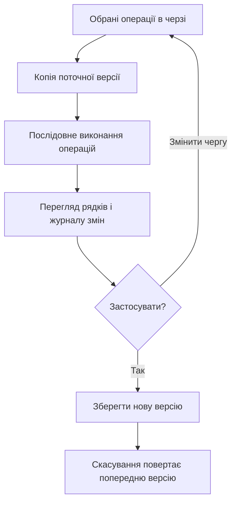

# Алгоритми

Фінансовий ETL перевіряє підтверджувану суму й конфлікти ключа до дедуплікації. Перелік прийнятих сум на звірку зберігається окремо. Відбір прогнозу описано у [фінансових алгоритмах](FINANCIAL_OPS.md).

## Завантаження та перевірка

CSV підтримує UTF-8 з BOM і без, UTF-16 з BOM, Windows-1251 та роздільники кома, крапка з комою, табуляція й вертикальна риска. Перед створенням DataFrame перевіряються ширина рядків і обсяг таблиці. Для XLSX використовується перший аркуш. Порожні та суто пробільні значення вважаються пропусками.

Повні дублікати визначаються за всіма стовпцями, ключові — за вибраними не порожніми компонентами ключа. У кожній групі перше входження зберігається. Один рядок може бути записаний у таблицю проблем кілька разів, якщо спрацювали різні перевірки. Валідність електронної адреси оцінюється за структурою, а перевірка дати спочатку розпізнає форми з роком на початку, для інших форм надає перевагу порядку день–місяць.

## Статистичні аномалії

- IQR позначає числові значення за межами від `Q1 − 1,5 × IQR` до `Q3 + 1,5 × IQR`.
- Z-score позначає значення з `|x − μ| > 3σ`. Використано стандартне відхилення з дільником `n`.
- Обидва методи пропускають відсутні та нечислові значення, зокрема нескінченності. Якщо скінченних чисел менше чотирьох або міра розкиду дорівнює нулю, спрацювань немає.

## Очищення й скасування

Середнє та медіана обчислюються за скінченними числами. Мода бере перше значення, повернуте pandas у разі нічиєї. Для заміни аномалій медіана рахується за значеннями без спрацювань. Нормалізація стискає послідовності пробільних символів. Словник категорій зіставляє нормалізовані назви без урахування регістру. Приведення нечитабельних чисел і дат створює пропуски. Валідні дати стандартизуються до ISO `YYYY-MM-DD`.
