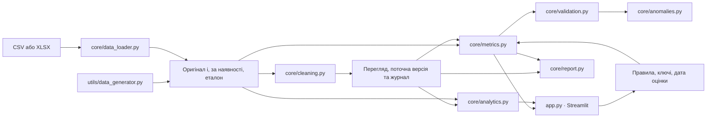

# Архітектура

Новий дашборд ефективності читає виміри досліду з docs/results, а сторінка ML використовує локальний реєстр. [Схема архітектури](diagrams/ARCHITECTURE.svg).

Цей розділ описує загальний табличний модуль. Постійне сховище, фінансова зірка та реєстр моделей описані в [архітектурі Financial Ops](FINANCIAL_OPS.md).

Підхід ґрунтується на виділенні обчислень в окремий шар. Streamlit відповідає за наведення, параметри правил, стан сеансу та відображення. Модулі ядра одержують DataFrame і параметри та повертають результати, тому їх можна перевіряти без браузера. Plotly будує інтерактивні графіки у браузері.

Сеанс тримає оригінал, еталон і версії після кожного застосування. Черга та попередній перегляд зберігаються окремо. Результат аналізу повторно використовується, доки версія даних та конфігурація правил збігаються. Компоненти не потребують бази даних або облікового запису.

Вхідні обмеження становлять 25 МБ, до 500 стовпців, до 250 000 рядків і до 2,5 млн комірок. Для XLSX додатково перевіряється розмір розпакованого архіву. На екрані показуються обмежені вибірки, а повний перелік проблем готується для експорту за запитом. Послідовні застосування очищення зберігають знімки для скасування, тому витрати пам’яті ростуть із кількістю збережених версій.
